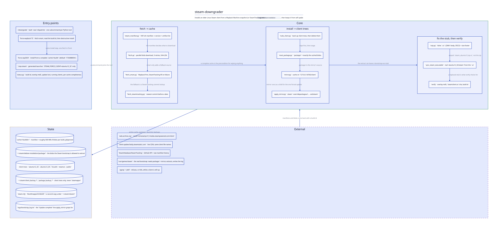

# steam-downgrader

Installs an older Linux Steam client out of a Wayback Machine snapshot (or SteamTracking history) into `~/.steam/debian-installation`, so you can reproduce an overlay or webhelper bug on a known build and then put the current client back.

Read it left to right:

- **The cache is the unit of work, and it is checked, not trusted.** Every install path starts from `cache/<buildid>/` — one manifest plus its blobs, roughly 500 MB — and `require_cache_complete` refuses to wipe anything if a single blob is missing or zero bytes. That is why `status` prints `complete` / `INCOMPLETE (N missing)` per build, and why copying `cache/1726088054/` from another machine is a supported workflow.
- **Wayback is a file server, not a build index.** The Archive answers with whatever file name you ask for, but blobs are often 404; `fetch_smart` parses the calendar date out of the Wayback timestamp (`20250413062507` → `2025-04-13`), looks up the newest SteamTracking commit before that date, and fills only the gaps from Fastly. The fill can be a different build than the snapshot you named — the README's Sep 11 vs Sep 13 table is exactly that trap.
- **The install runs Steam against your own machine.** `force_sep2024` backs the client trees up to `~/.steam/client_backup_*`, deletes them, rewrites `package/` as exactly the cached blobs (aliasing the ubuntu12 manifest as the steamrt64 one), then `apply_mirror` serves that cache on `127.0.0.1:8765` and launches `/usr/games/steam -overridepackageurl … -forcesteamupdate -exitsteam`. Success is not the exit code; it is `build <id>` plus `Update complete` appearing in `logs/bootstrap_log.txt` after the run started.
- **A downgraded client needs a downgraded launcher.** `force_sep2024` writes `./sep-steam`, which clears `.steam-enable-steamrt64-client` and exports `STEAM_FORCE_CLIENT=ubuntu12_32`, because the extract leaves a modern bootstrap-era `ubuntu12_32/steam`. `sync_steam_executable` replaces that stub with the real binary from `steam_ubuntu12.zip.vz` (a VZa blob: LZMA1 body, CRC32 + size footer), and `verify` fails if the file still matches `bootstrap.tar.xz`.
- **Two known rough edges.** `force_sep2024.py` calls `require_cache_complete` but never imports it, so the guarded path raises `NameError` before the wipe (fail-safe, but loud); and nothing pins the Archive snapshot's build id to the manifest you actually get when the Fastly fallback kicks in, so check `list-cache` before trusting a timestamp.

Diagram source: [`docs/system.d2`](docs/system.d2) · renderer: [`scripts/render-diagram.sh`](scripts/render-diagram.sh).
